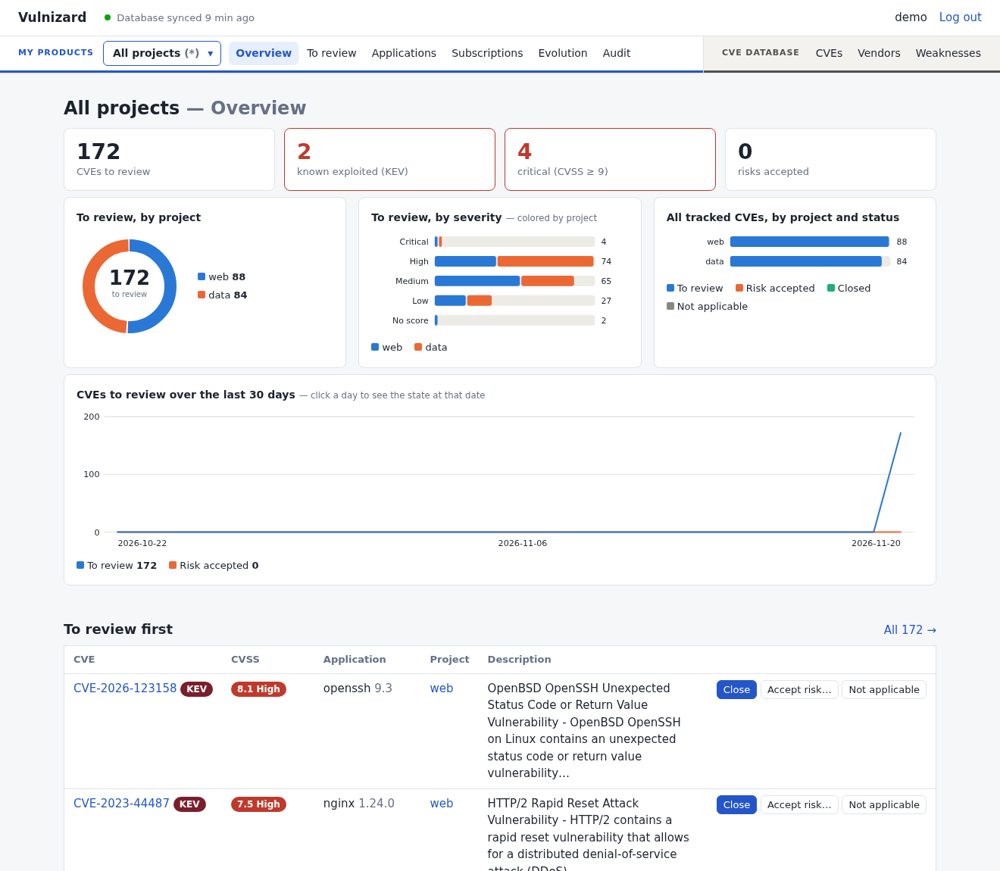

<p align="center"></p>

# Vulnizard

Self-hosted vulnerability tracking in a single binary. Follow the CVEs that affect what you run,
decide what to do about each one, and keep the trace of who decided what.

> **Disclaimer.** Vulnizard is largely written by an AI coding assistant under human direction and
> has had no independent security audit. It comes with no warranty and no liability of any kind, its
> data can be wrong or incomplete, it has not been tested at scale, several features were never
> tried against the real third-party service, and it should not be exposed to the Internet. Read
> the full [disclaimer](DISCLAIMER.md) and [what has been tested](https://github.com/likarum/Vulnizard/wiki/What-has-been-tested).



## Why

Vulnizard comes from two problems met in practice:

- **No light self-hosted option.** The existing tools need a database server, a queue, workers.
  Vulnizard is one binary and one SQLite file, and stays small in memory.
- **The "SSO tax".** Hosted products keep single sign-on and two-step sign-in for their expensive
  plans, out of reach of small companies that still need this bare minimum. Here they are part of
  the tool.

It is also meant for AI assistants: the same data and the same rights through MCP.

## Web interface

- **Projects** grouped in organizations, with roles (owner, editor, viewer) at instance,
  organization or project level
- **Applications** you run, with their version: the CVEs affecting that version are listed
- **Triage**: close, accept the risk with a justification, or mark not applicable
- **Subscriptions** to vendors and products, with daily reports of what changed
- **Notifications** by email, ntfy, Slack, webhook or browser, per project, filtered by event and CVSS
- **Evolution and audit**: charts over time, state at any past date, who decided what and why
- **CVE database** to browse: search, vendors, products, weaknesses, change history, personal tags
- **Sources**: NVD, CISA KEV, EPSS, CISA Vulnrichment (SSVC), OSV, Exploit-DB, Metasploit —
  synchronized in the background, on a schedule you set
- **Sign-in**: passwords, OpenID Connect (SSO), SCIM provisioning, authenticator app, passkeys,
  recovery codes; two-step sign-in can be required
- **Logs that show tampering**: the security log and the audit of decisions are chained and export
  as signed files anyone can verify offline

Details: [web interface](docs/web.md) · [administration, users and sign-in](docs/administration.md)

## MCP server

- **Same tools over HTTP or stdio** for AI assistants ([Model Context Protocol](https://modelcontextprotocol.io))
- **Acts as a user**: over HTTP the assistant has that user's organizations and role, nothing more
- **Read**: search CVEs, projects, applications, what is to review, reports, evolution, audit
- **Write** (off by default): track an application, change its version, subscribe, record a decision
- **Traced**: decisions made by an assistant are in the audit under the user's name

Details: [MCP server](docs/mcp.md)

## Also

- **Read-only REST API** with personal tokens
- **Command line** to synchronize, search and print CVEs without the web server
- **Inventory collection** (preview, off by default): machines report what they run instead of
  typing versions by hand — [details](docs/inventory.md)

## Quick start

The first administrator is created from the command line; nothing is open by default.

**Docker**

```bash
docker compose up -d
docker compose exec vulnizard vulnizard user create admin --admin   # asks for the password
```

**NixOS** (flake)

```nix
imports = [ inputs.vulnizard.nixosModules.default ];
services.vulnizard = { enable = true; baseUrl = "https://vulnizard.example.org"; };
```

```bash
sudo vulnizard-admin user create admin --admin
```

**From source**

```bash
cargo build --release
./target/release/vulnizard user create admin --admin
./target/release/vulnizard serve        # http://127.0.0.1:8000
```

The first import of the CVE database starts by itself and takes a while. Then open the address,
sign in, and add what you run. Reverse proxy, HTTPS and settings: [deployment](docs/deployment.md).

## Documentation

- [Web interface](docs/web.md)
- [Administration, users and sign-in](docs/administration.md)
- [MCP server](docs/mcp.md)
- [Deployment and configuration](docs/deployment.md)
- [Command line](docs/cli.md)
- [Inventory collection (preview)](docs/inventory.md)
- [What has been tested](https://github.com/likarum/Vulnizard/wiki/What-has-been-tested) — how far each feature was really verified

## Project

- What changed: [changelog](CHANGELOG.md)
- Planned work: [issues](https://github.com/likarum/Vulnizard/issues)
- Next (0.2): [signed and exportable logs](https://github.com/likarum/Vulnizard/issues/1), so that a change to the audit or security log can be detected
- Reporting a vulnerability: [SECURITY.md](SECURITY.md)
- License: [MIT](LICENSE) — and read the [disclaimer](DISCLAIMER.md)
