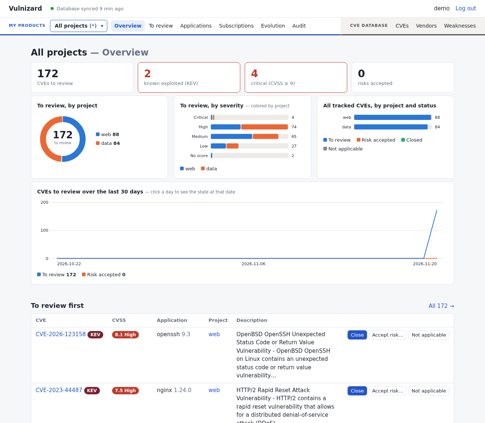

# Web interface

`vulnizard serve` turns the same binary and SQLite database into a self-hosted
vulnerability monitoring platform, with no external service (no PostgreSQL,
Redis, Airflow or JS build): pages are compiled into the binary and the
scheduler runs in-process.



```bash
vulnizard sync                      # initial import (once)
vulnizard serve                     # http://127.0.0.1:8000
vulnizard setup-code                # code asked by the setup page at first visit
# or, without the page: vulnizard user create alice --admin
```

The navigation has two visibly separate sides, and the header always shows when the
database was last synchronized (administrators can start a sync from there):

- **My products** — what you run and follow. A project selector (all projects `*` by default)
  filters every view:
  - *Overview*: counters and charts. With all projects, each project has its own color and each
    severity level its own bar; for a single project, severity levels are told apart by color
  - *Vulnerabilities*: CVEs affecting the deployed versions. Those still to review are listed
    first (the default filter); the other filters list those overdue and those already decided.
    **Close** once fixed, **accept the risk** with a justification, or mark **not applicable**.
    The *Due* column says how long is left to decide — "in 12 days", "today", or a red
    "overdue by 5 days" — and sorts; the dates are in its tooltip. An entry is due a number of
    days after its **detection**, according to the severity its CVE has today (7 days for
    critical, 30 for high, 90 for medium, 180 for low by default; a CVE without a score follows
    the medium delay), or after the delay of exploited CVEs (CISA KEV, 14 days) when that is
    shorter. Any decision stops the clock: a decided entry is never overdue. An entry reopened is
    due at its first deadline again, and changing the version of the application moves nothing.
    The delays are set for the instance and may be replaced by an organization (see
    *Administration*); with all projects shown, each entry follows those of its organization
  - *Applications*: what you run and in which version (rescanned after every sync; changing the
    version closes the CVEs it fixes, and an entry still to review that no longer matches after a
    source corrected its data is set aside as not applicable). The name is the product name of
    the CVE database, matched exactly (case and separators aside: `home_assistant` is
    `home-assistant`, `podman` is not `podman_desktop`; with a vendor, the products of that vendor
    named after the application count too, as `nginx_open_source` for `nginx`); a package ecosystem (Go, npm, PyPI,
    crates.io, Maven) also matches the advisories of the package of that name, at the version.
    When the sources disagree on a CVE, the one that gives versions decides; a CVE for which
    no source gives any version matches every version (better a false alert than a missed one)
    and is marked *version not given* in the list to review: read it before deciding.
    An application marked *unknown to the sources* has no CVE recorded under its name at any
    version, which is not the same as having none at its version. Then the **inventory sources** of the project and the checklist of
    what they discovered (see *Collecting what is deployed*)
  - *Subscriptions*: vendors or products whose every CVE change you follow, without a version:
    the changes go into the daily reports and the notifications. An application, with its
    version, feeds the list of vulnerabilities instead
  - Applications and subscriptions are added with the **+** button at the top of their view. With
    all projects shown, the form asks for the project, among those you may manage
  - *History*: stock and daily activity (new, accepted, closed) over 30/90/365 days, and the
    state of every tracked CVE **at any past date**: click a day in a chart, or pick it in the
    date field. A past state is marked as such, with a link back to today
  - *Audit*: who decided what, when and why — accepted risks first
  - *Settings* (per project): the project's own notification **destinations** (email with its own
    SMTP server, ntfy, Slack, webhook) in one table: a row per destination, a checkbox
    per event type, a minimum CVSS, saved together. A new destination starts with every event
    checked; one with no event checked sends nothing. Destinations of the organization or of the
    instance also receive the project's notifications: they are managed by their administrators
    and are not shown here. Members with a right on the project only, and the invitations
    pending for it: a name typed there is invited, and gets the role when the person accepts
    (see [Administration](administration.md#users-roles-and-single-sign-on))
- **CVE database** — reference information: CVEs (keyword, CVE-ID, vendor, product, CVSS, CWE,
  KEV, personal tags) with their change history, vendors & products, weaknesses
- **Background scheduler**: periodic incremental sync, then reports, watchlist rescan and
  notifications (`web.sync_interval_minutes`). The NVD, Vulnrichment and OSV read only what
  changed since the last run (OSV reads its whole archives, about 290 MB, the first time and once
  a month). The other sources download one file each (2 to 11 MB; 85 MB for the Debian advisories)
  and only when it changed upstream; they are asked at most every 6 h (KEV), 12 h (Exploit-DB,
  Debian advisories) or 24 h (EPSS, Metasploit, Nuclei), whatever the interval. *Admin → Sources*
  shows it per source; "Sync now" there asks at once, without waiting
- **Read-only REST API** under `/api` (`Authorization: Bearer <token>` created in *Settings*, or HTTP Basic):
  `/api/cve`, `/api/cve/{id}`, `/api/vendors`, `/api/vendors/{vendor}/products`, `/api/weaknesses`,
  `/api/organizations`, `/api/organizations/{org}/projects[/{project}[/reports[/{day}]]]`,
  `/api/organizations/{org}/projects/{project}/watchlist` (the tracked CVEs of a project,
  200 per page: `?status=untreated|accepted|treated|not_applicable`, `?overdue=1` for the entries
  to review past their deadline, most overdue first, `?page=`; an entry to review carries `due_at`
  (a day, UTC), `days_left` (negative once overdue) and `overdue_days`, a decided one
  `resolved_in_days`, from its detection to the decision),
  `/api/organizations/{org}/audit` and `/api/security-log` (signed log exports, see *Administration*)

Charts are SVG rendered by the server. The JavaScript shipped is a handful of small same-origin
files: passkeys, filters that apply while typing, and the
color theme. Every list can be sorted (click a column header, click again to reverse) and
filtered with its search box; everything works without JavaScript except passkeys
and the choice of a theme.

The header has a menu of **color themes** (Classic, Forest, Plum, Sand, Dracula, Nord, Noctis, High contrast) and a
**day / night** button. The choice is kept in the browser, not in the account: another browser
starts from the default. Until the button is used, day or night follows the system setting, and
keeps following it; without JavaScript the page is Classic and follows the system setting too.
Severity badges and marks keep the same colors in every theme.

---
[← Back to the README](../README.md)
